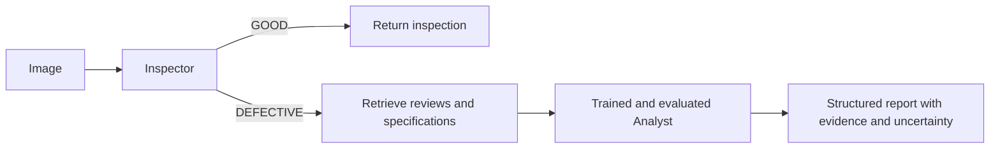

# RiskLens · Build Custom AI capstone

Build a product-risk pipeline that inspects an image, retrieves supporting evidence and generates a report with a trained Analyst. Develop it across five module milestones, and support each claim with saved evidence.

[Open the starter in Colab](https://colab.research.google.com/github/SarasAI-Institute/Building-Custom-AI-Capstone/blob/codex/competency-colab-refresh/capstone_starter.ipynb) · [Competency rubric](RUBRICS.md) · [Setup](docs/COLAB.md) · [Submission checklist](docs/SUBMISSION.md) · [Practice labs](https://github.com/SarasAI-Institute/Building-Custom-AI-Main)

## Start here

1. Save your own starter notebook copy. Use a Colab GPU runtime for the complete project; see the setup and validation limits below.
2. Read Section 0 and the stable [contracts](docs/CONTRACTS.md). The three deliberate inspector defects remain part of the assignment.
3. Freeze D1.1 before experimenting with prompts. Complete the labeled workspaces and add your evidence beneath them.
4. Submit the same notebook link at each milestone, with saved outputs, a completion summary, known issues and a dated snapshot.

## What completion means

Every criterion is **Met** or **Not Yet**. Every criterion in a competency must be Met for that competency to be **Mastered**. All five competencies must be Mastered for the project to be Mastered. There are **24 required criteria**; metrics are evidence, not averaged grades.

| Module | Build and demonstrate | Evidence | Review first |
|---|---|---|---|
| 1 | Visual inspection and evaluation | D1.1–D1.7 / C1.1–C1.5 | C1.1 frozen split |
| 2 | Grounded retrieval and generation | D2.1–D2.7 / C2.1–C2.5 | C2.3 grounded answers |
| 3 | Model adaptation and evaluation | D3.1–D3.7 / C3.1–C3.5 | C3.2 evaluation separation |
| 4 | Optimization and deployment decisions | D4.1–D4.4 / C4.1–C4.5 | C4.2 predeclared gate |
| 5 | Integration, delivery and explanation | D4.5–D4.7 + final delivery / C5.1–C5.4 | C5.1 real integration |

Module 4 has its own quality/benchmark checkpoint. Module 5 adds integration and the combined Stage 4 evaluation. The legacy D4 labels remain stable so existing learner work is still navigable.

## Work responsibly with evidence

Use development data for decisions. A cell appearing above another does not prove chronology. Keep full outputs, manifests, actual model/data revisions, training logs and failed experiments. A format score or refusal phrase is not proof of factual correctness. The project is an educational product-risk prototype; a photograph does not establish an unseen physical cause.

The inspector and retriever must improve their specified baseline metrics. The Analyst has no invented minimum win-rate. A failed compression experiment can demonstrate sound reasoning when reported honestly with a feasible fallback. Read the exact criterion before interpreting a number.

## Repository guide

- `capstone_starter.ipynb` — the one continuing learner project; explicit TODOs are intentional.
- `RUBRICS.md`, `assessment/criteria.json` — readable and machine-readable versions of the same 24 criteria.
- `assessment/reference/` — supplied official PDFs, unchanged and hashed.
- `assessment/REVIEWER_GUIDE.md` — review order, feedback and calibration examples.
- `docs/` — Colab setup, contracts, milestones, migration and validation record.
- `risklens_support.py` — tested evidence/measurement helpers, also embedded in the standalone notebook.
- `tests/`, `scripts/`, `.github/workflows/` — repeatable structural and CPU checks.

## Validation

See [VALIDATION.md](docs/VALIDATION.md) for the exact tests run and GPU checks still required. CPU tests are not a claim that a full T4 training/compression run has passed. Colab hardware availability varies; preserve its matched PyTorch/CUDA stack and save artifacts beyond the temporary runtime.

Optional hosting, graph frameworks and distillation do not replace required evidence. The full revision policy is in the rubric; administrative arrangements follow published course policy.
